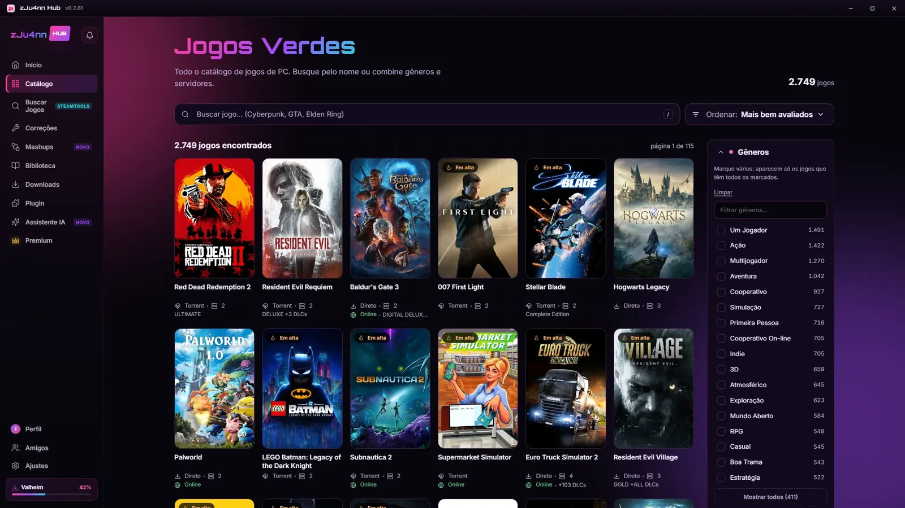
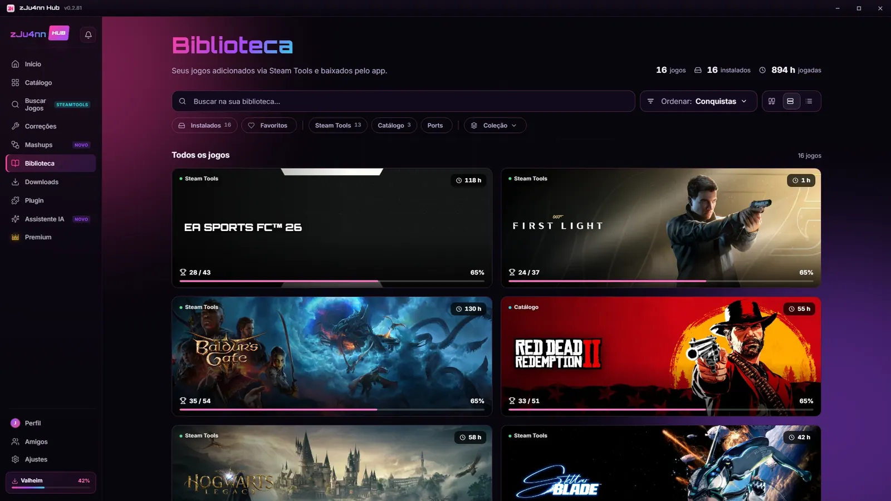
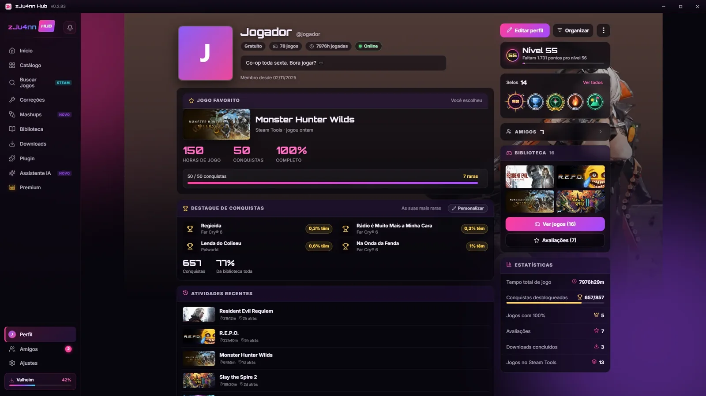
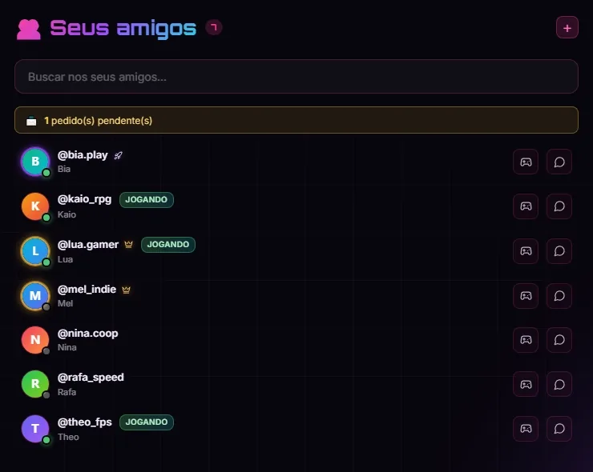
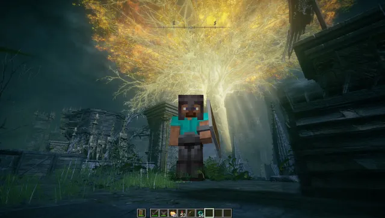
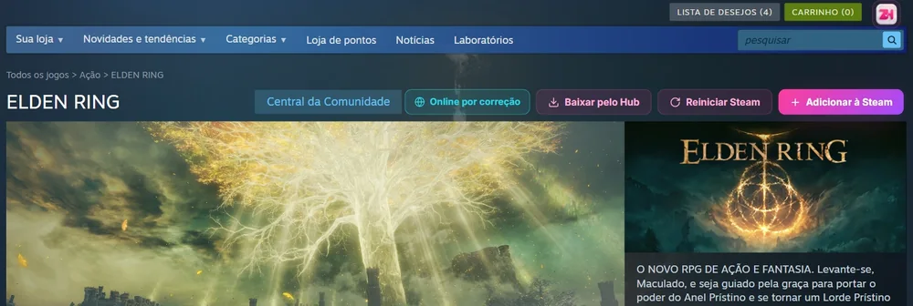

<h1>zJu4nn Hub</h1>

<b>Todos os seus jogos de PC num cantinho só.</b> 
App grátis pra Windows e Linux, feito no Brasil 💜

 

&nbsp;

🇧🇷 <a href="https://zju4nnhub.com">Português</a> · 🇺🇸 <a href="https://zju4nnhub.com/en">English</a> · 🇪🇸 <a href="https://zju4nnhub.com/es">Español</a>

  

 

## 🎮 O que é

O **zJu4nn Hub** junta tudo o que você precisa pra jogar no PC: um catálogo com **mais de 2.900 jogos** que você instala com **um clique**, suas **conquistas e horas de jogo** contadas sozinhas, **amigos online** pra ver quem tá jogando o quê e **saves na nuvem** pra nunca perder o progresso.

Você entra com o seu **Discord**, sem criar senha nova. O app é **100% grátis e sem anúncio** — e fala **português, inglês e espanhol**.

 

## ✨ Tudo num app só

<table>
  <tr>
    <td width="50%" valign="top">
      
      <h3>📚 Sua biblioteca</h3>
      Todos os seus jogos com capa, tempo de jogo e conquistas. Fechou 100%? O card fica dourado.
    </td>
    <td width="50%" valign="top">
      
      <h3>⭐ Nível, selos e perfil</h3>
      Cada hora jogada vira ponto. Suba até o nível 200, ganhe selos e deixe o perfil com fundo animado.
    </td>
  </tr>
  <tr>
    <td width="50%" valign="top">
      
      <h3>👥 Amigos online</h3>
      Veja quem tá online e o que cada um tá jogando agora. Combine a jogatina pelo chat, sem sair do Hub.
    </td>
    <td width="50%" valign="top">
      
      <h3>🔀 Mashups</h3>
      Dois jogos num só: Minecraft dentro do Elden Ring, GTA V com blocos e muito mais, instalados com um clique.
    </td>
  </tr>
  <tr>
    <td colspan="2" valign="top">
      
      <h3>🧩 O Hub dentro da Steam</h3>
      Abriu um jogo na loja da Steam? Os botões do Hub aparecem ali mesmo: baixar, colocar na sua Steam e liberar o online.
    </td>
  </tr>
</table>

**E ainda:** 🖥️ **Roda no seu PC?** em cada jogo · ☁️ **Saves na nuvem** · 🎮 **Jogos de console no PC** (Bloodborne e God of War III) · 🤖 **Assistente IA** · ⭐ **Avaliações** · 🎨 **7 temas** ou o seu · 🔔 avisos por cima do jogo · ⚙️ se atualiza sozinho

 

## 📥 Como instalar

| 🪟 Windows 10 e 11 | 🐧 Linux |
| :-- | :-- |
| 1. Entre em **[zju4nnhub.com](https://zju4nnhub.com)** e clique em **Baixar pra Windows** | 1. Baixe o **[AppImage](https://github.com/zJu4nn-Hub/zju4nnhub/releases/latest/download/zJu4nn-Hub-x86_64.AppImage)** |
| 2. Abra o instalador (se o Windows perguntar: **Mais informações** → **Executar mesmo assim**) | 2. Clique com o botão direito → **Propriedades** → marque **Permitir executar como programa** |
| 3. Entre com o Discord e pronto 🎮 | 3. Abra, entre com o Discord e pronto 🎮 |

 

## 🛡️ É seguro?

**Sim.** A versão 0.2.83 passou pelos **67 antivírus do [VirusTotal](https://www.virustotal.com/gui/file/5b1a5673c9718c9e35433a4ff400280cc15657b7a921a0caf01a26a720dd9805) e nenhum achou problema.**

Se o Windows mostrar uma tela azul de aviso, é só porque o instalador ainda não tem a assinatura digital paga. Baixe sempre pelo **[site oficial](https://zju4nnhub.com)** ou pelas **[versões aqui do GitHub](https://github.com/zJu4nn-Hub/zju4nnhub/releases)**.

 

## 👑 Premium

O Hub é grátis pra sempre. O Premium é pra quem quer ir além — e ajuda a manter o projeto vivo.

☁️ Saves na nuvem automáticos · 🔄 Biblioteca em qualquer PC · 🤖 Assistente IA · 🖼️ Todos os fundos do perfil · 👑 Selo dourado · 💎 Canal exclusivo no Discord

**R$ 9,90/mês** ou **R$ 99,90/ano** — fora do Brasil, em dólar ou euro. **[Conhecer o Premium →](https://zju4nnhub.com/premium)**

 

<b>🇺🇸 In English</b>

 

**zJu4nn Hub** is a free PC game launcher for **Windows and Linux**, made in Brazil. Browse a catalog of **2,900+ games** and install them in one click, track your **achievements and playtime**, see which **friends are online**, and keep your **saves in the cloud** (Premium). Log in with **Discord** — no new password. The app speaks English, Spanish and Portuguese.

**[Download at zju4nnhub.com/en →](https://zju4nnhub.com/en)**

<b>🇪🇸 En español</b>

 

**zJu4nn Hub** es un launcher gratis de juegos de PC para **Windows y Linux**, hecho en Brasil. Explora un catálogo con **más de 2900 juegos** y los instalas con un clic, sigue tus **logros y tiempo de juego**, mira qué **amigos están en línea** y guarda tus **partidas en la nube** (Premium). Entras con **Discord**, sin contraseña nueva. La app habla español, inglés y portugués.

**[Descárgalo en zju4nnhub.com/es →](https://zju4nnhub.com/es)**

 

### 💬 Bora jogar junto?

Dúvida, bug ou ideia? A galera tá no Discord.

  

Feito com 💜 no Brasil · <a href="https://zju4nnhub.com">zju4nnhub.com</a> · © 2026 zJu4nn

